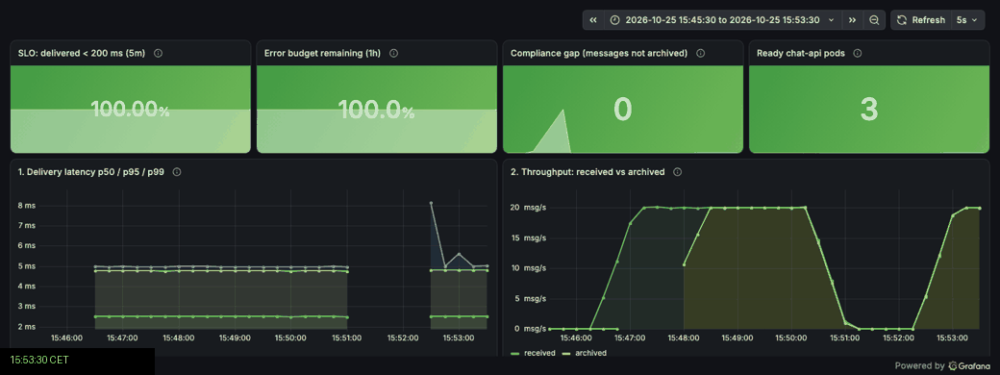
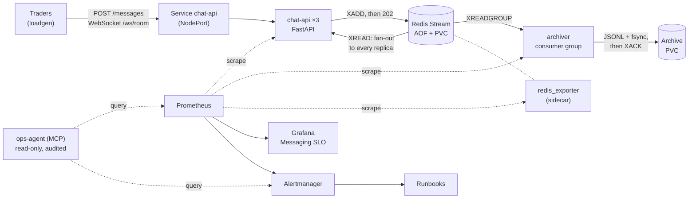
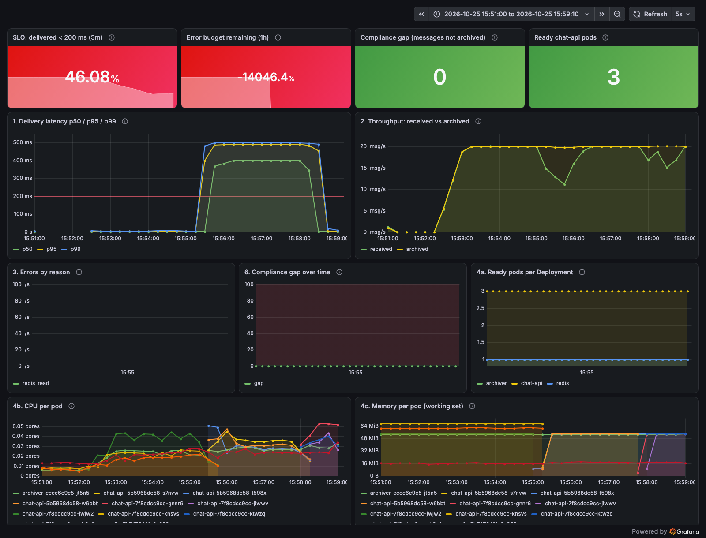
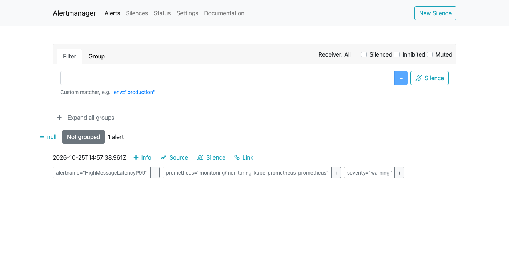

# tradechat-sre-demo

[](https://github.com/BaderOukhai/tradechat-sre-demo/actions/workflows/ci.yml) · 🇫🇷 [Version française](README.fr.md) · **[One-minute case study →](https://baderoukhai.com/en/tradechat)**

> **Traders chat in real time, and the law says every message must be archived.**
> So the system makes two promises: *fast*, and *nothing lost*.
> I built a miniature of that platform on Kubernetes — then spent as much time trying to break it.



*A bad release ships: delivery p99 jumps from 5 ms to ~500 ms, the alert fires, one command rolls
it back — **161 s to detect, 79 s to recover, 0 messages lost**
([postmortem](docs/postmortems/2026-10-25-latency-regression.md)).*

## Act 1 — Build it: fast, and nothing lost

- A message is written to a durable log (a Redis Stream on a persistent volume) **before** the
  trader gets `202 Accepted`.
- Three API replicas, spread over two nodes, push it to every connected trader over WebSockets:
  **p99 ≈ 12–17 ms** under load, against an SLO of 99.9% under 200 ms.
- An archiver reads the same log through a consumer group and acknowledges a message only **after**
  it is on disk: a crash can duplicate a message, never lose it.
- Every commit goes through a pipeline that scans for secrets and vulnerabilities, **deploys to a
  throwaway Kubernetes cluster, runs 20 simulated traders, and rejects the release if the SLO is
  missed or a single message isn't archived** — the verdict is on the [run page](https://github.com/BaderOukhai/tradechat-sre-demo/actions/workflows/ci.yml).

## Act 2 — Break it on purpose

| I… | The system… | Measured |
|---|---|---|
| killed an API pod under load | routed around it | 0 HTTP errors, 2 399 / 2 399 messages archived ([dashboard](docs/assets/dashboard-resilience.png)) |
| stopped the archiver | kept the backlog, paged (critical), caught up | alert after 75 s, 1 249 messages drained in < 15 s ([dashboard](docs/assets/dashboard-compliance.png)) |
| shipped a release 300 ms slower | paged, rolled back with one command | detect 161 s, recover 79 s, 0 lost ([dashboard](docs/assets/dashboard-incident.png)) |
| shipped a release that runs out of memory | refused to roll it out | old pods kept serving, no user impact |
| handed deployments over to GitOps (Argo CD) | reverted my manual change by itself | drift undone in < 5 s, archive kept |
| asked an AI assistant *"is the platform healthy?"* | answered from live alerts and runbooks — read-only, audited | every call in an audit log |

## Act 3 — What breaking it taught me

Breaking it on purpose found seven real problems that a green test suite didn't:

1. **A Redis restart left a dead connection in the pool**: the next request failed → reconnect and retry.
2. **The compliance metric cried wolf on every pod restart** (counters reset to 0) → measure at the source, in Redis.
3. **`helm upgrade` silently undid a manual fix** → a fix made during an incident isn't done until it's in Git.
4. **An alert kept paging 5 minutes after the fix** → shorter evaluation window.
5. **Rolling updates cut in-flight requests** → a 5 s `preStop` delay → 0 errors.
6. **Grafana ran out of memory during the incident it was showing** → sized from observation.
7. **A kubeconfig with the cluster's private key slipped into a commit** → caught before the push,
   then automated: secret scanning in a pre-commit hook and in CI, checked against that very file.

**Proof, not promises:** [CI runs with the deploy report](https://github.com/BaderOukhai/tradechat-sre-demo/actions/workflows/ci.yml) ·
[postmortem](docs/postmortems/2026-10-25-latency-regression.md) · [runbooks](docs/runbooks/) ·
[CI design](docs/ci.md)

---

## Under the hood

Everything below is the technical detail: architecture, how to run it, and the decisions behind it.

## Architecture



- **chat-api** persists each message (`XADD`) before answering `202`, then every replica tails the
  stream (`XREAD`) and pushes messages to *its own* WebSocket clients: a trader connected to pod A
  receives a message posted to pod B.
- **archiver** reads the same stream through a **consumer group** (each message to one archiver,
  Redis keeps the bookmark and the pending list): write + `fsync`, then `XACK`. A crash means a
  re-delivery (duplicate, deduplicated by id), never a loss; `XAUTOCLAIM` takes over messages a
  dead archiver left unacknowledged.
- **Compliance gap** = consumer group lag + pending, measured at the source by `redis_exporter`,
  independently of the archiver it watches.

## Quickstart

Prerequisites: Docker (Desktop or OrbStack, ~6 GB RAM), `kind`, `kubectl`, `helm`, `uv`, Python 3.12.

```bash
make tools                               # check prerequisites
make cluster images monitoring deploy    # kind cluster, images, Prometheus/Grafana, the app (~3 min)
make load                                # 20 simulated traders for 2 minutes, prints p50/p95/p99
make urls                                # Grafana, Prometheus, Alertmanager URLs + Grafana password
```

| URL | |
|---|---|
| http://localhost:3000/d/messaging-slo | Grafana dashboard (anonymous, read-only) |
| http://localhost:9090 | Prometheus |
| http://localhost:9093 | Alertmanager |
| http://localhost:8000 | chat-api (`POST /messages`, `GET /ws/{room}`, `/healthz`, `/readyz`, `/metrics`) |

Faster dev loop without Kubernetes: `make up` (docker compose) and `make down`.

## Demo scenarios

| Scenario | Command | What you see |
|---|---|---|
| **Pod failure** | `kubectl delete pod <chat-api pod>` during `make load` | short dip in ready pods ([screenshot](docs/assets/dashboard-resilience.png)); measured: 0 HTTP errors, 2 399 / 2 399 messages archived, p99 11.9 ms |
| **Incident drill** | `make load ARGS="--duration 600"` then `make incident` | bad release (+300 ms) → `HighMessageLatencyP99` fires → `helm rollback` → recovery, with a timeline |
| **Compliance** | `kubectl scale deploy archiver --replicas=0` during load | gap grows 20 msg/s, `ComplianceArchiveGap` (critical) fires; scale back → backlog drained in < 15 s |
| **Bad release blocked** | `helm upgrade tradechat deploy/helm/tradechat --set chatApi.resources.limits.memory=40Mi --set chatApi.resources.requests.memory=32Mi` | new pod OOMKilled, rollout stuck, old pods keep serving, `PodCrashLooping` fires |
| **Ask the ops agent** | Claude Code at the repo root: *"Is the messaging platform healthy? What should I do?"* | alerts + SLO + compliance gap + the runbook, every call in `ops-agent/audit.log` |

The full live demo (3 minutes) is in [docs/DEMO_SCRIPT.md](docs/DEMO_SCRIPT.md) (in French).


| Incident drill (bad release → rollback) | Alertmanager during the incident |
|---|---|
|  |  |

Measured: **time to detect 161 s, time to mitigate 79 s**, 0 messages lost — see the [postmortem](docs/postmortems/2026-10-25-latency-regression.md).

## SLO and error budget

- **SLO:** 99.9% of messages delivered (reception → WebSocket fan-out) in under **200 ms**.
- **SLI** = good / total = `rate(chat_message_delivery_seconds_bucket{le="0.2"}) / rate(chat_message_delivery_seconds_count)` — which is why `0.2` is a histogram bucket boundary.
- **Error budget** = 1 − SLO = 0.1% of messages. Remaining = `1 − (bad / total) / 0.001`
  (rolling 1 h window in the demo, 30 days in production).
- **Why 200 ms:** the order of magnitude at which a trader notices a late message; normal p99 is
  ~5–17 ms, so the alert only fires on a real regression.

## Alerts

| Alert | Condition | Severity | Runbook |
|---|---|---|---|
| `HighMessageLatencyP99` | p99 > 200 ms for 2 min | warning | [runbook](docs/runbooks/HighMessageLatencyP99.md) |
| `ComplianceArchiveGap` | messages not archived (or not measurable) for 1 min | **critical** | [runbook](docs/runbooks/ComplianceArchiveGap.md) |
| `PodCrashLooping` | a container in CrashLoopBackOff for 1 min | warning | [runbook](docs/runbooks/PodCrashLooping.md) |

Compliance is critical and latency only a warning: a slow chat degrades the experience, an
incomplete archive is a potential regulatory breach for the customer bank.
Incident write-up: [docs/postmortems/](docs/postmortems/).

## Repository layout

```
apps/chat-api/          FastAPI service: POST /messages, WebSocket fan-out, probes, metrics, fault injection
apps/archiver/          consumer-group archiver: JSONL + fsync, then XACK
loadgen/                simulated traders (asyncio), client-side latency percentiles
deploy/kind-config.yaml 1 control-plane + 2 workers, NodePorts mapped to localhost
deploy/helm/tradechat/  the app chart: Deployments, Services, PVCs, PDB, ServiceMonitors, alerts, dashboard
deploy/monitoring/      trimmed kube-prometheus-stack values
deploy/argocd/          GitOps: Argo CD values + Application (optional, make gitops)
deploy/basics/          plain manifests used to learn the Kubernetes building blocks (step 6a)
terraform/              the whole environment as code (kind + Helm providers)
ops-agent/              read-only MCP server for on-call (SLO, alerts, runbooks, compliance gap)
scripts/incident.sh     incident drill with a timeline
docs/                   runbooks, postmortem, CI notes, demo script, screenshots
```

## Design decisions & trade-offs

- **Redis Streams, not Kafka.** One stream is both the durable log and the fan-out bus, and the
  consumer group gives at-least-once archiving. Kafka would be the production choice at scale
  (partitioning, replication); Redis keeps the demo small. Single Redis = a known single point of
  failure (mitigated here with AOF on a persistent volume only).
- **At-least-once, not exactly-once.** ACK after write: a crash can duplicate, never lose.
  Duplicates are removed by message id. In compliance, losing is illegal, duplicating is annoying.
- **Count a message as received only after `XADD`.** A `503` tells the client to retry; the
  received counter never includes messages that weren't persisted.
- **Compliance gap from Redis, not from counters.** `received − archived` from two counters gave a
  false alert on every pod restart (counters restart at 0). Lag + pending of the consumer group is
  the source of truth and survives restarts.
- **Liveness never checks Redis.** A Redis outage must take pods out of traffic (readiness), not
  restart all of them (cascading CrashLoopBackOff).
- **No CPU limit on chat-api.** Memory limits (incompressible, OOMKill) yes; CPU throttling would
  add latency and eat the SLO. Requests and limits come from measured usage.
- **Topology spread, not hard anti-affinity.** 3 replicas on 2 workers: a hard rule would leave a
  pod Pending forever; `maxSkew: 1` guarantees 2+1.
- **`maxUnavailable: 0`.** A release whose pods never become Ready can't take capacity away: the
  rollout blocks itself (verified with an OOMKilled release).
- **NodePort instead of `kubectl port-forward`.** A port-forward is pinned to one pod and dies with
  it; through the Service, killing a pod is invisible to clients.
- **The service ships its own observability.** ServiceMonitors, alerts and the dashboard live in
  the app chart, versioned with the code ("you build it, you own it").
- **Archive volumes survive `helm uninstall`** (`helm.sh/resource-policy: keep`).

## How this was built

Built with an AI coding assistant (**Claude Code**), as a deliberate learning project. The working
rules I gave it: small steps, explain the *why* before coding, every configuration value justified
in a comment, one commit per step, and **I** run the learning commands (`docker`, `kubectl`,
`helm`, `kind`) myself.

How I made sure I understand it rather than just own it:
- after each step, interview-style questions answered without notes, then corrected — kept as
  private study notes, wrong answers included;
- every claim is verified by running it: tests, a pod killed under load, alerts triggered on
  purpose, an OOMKilled release, a full incident drill with a measured timeline, the whole
  environment rebuilt with `terraform apply`, the MCP agent queried during a live incident, the
  release handed over to Argo CD (GitOps) without losing the archive;
- the bugs found along the way are documented with their diagnosis: a stale Redis connection after
  a restart, a counter reset faking a compliance gap, `helm upgrade` silently reverting a manual
  scale, an alert still firing 5 minutes after the fix, requests cut during rolling updates,
  Grafana OOMKilled, and a kubeconfig (with the cluster's private key) caught before it was pushed.

## What I'd do in production

- **Security:** mTLS between services (service mesh), secrets in a KMS / Vault, NetworkPolicies,
  signed images and admission control, hardened Redis image, end-to-end encryption with keys held
  by the customer (the key manager and encrypting agent on the customer's premises).
- **Data:** Kafka or replicated Redis instead of a single Redis; the archive on immutable
  (WORM) object storage with retention policies and legal holds; deduplication by message id at
  export time.
- **Availability:** multi-zone then multi-region, HPA on chat-api, a client that re-fetches history
  from its last message id after a reconnect.
- **SLOs:** per-customer SLOs, 30-day windows, multi-window burn-rate alerts, alert routing to an
  on-call tool, load tests in CI.
- **Delivery:** GitOps (Argo CD) as the only path to production, progressive delivery (canary),
  Terraform with a remote, locked state.

## More

- [docs/ci.md](docs/ci.md) — CI pipeline (GitHub Actions + Jenkinsfile), comparison with Cloud Build
- [terraform/README.md](terraform/README.md) — state, plan/apply, drift
- [ops-agent/README.md](ops-agent/README.md) — the MCP server and its guardrails
- [deploy/argocd/](deploy/argocd/) — GitOps with Argo CD: `make gitops`, rollback with `git revert`. Verified: synced from this repository in 20 s, a manual `kubectl scale` reverted by `selfHeal` in < 5 s, archive kept across the hand-over from Helm
